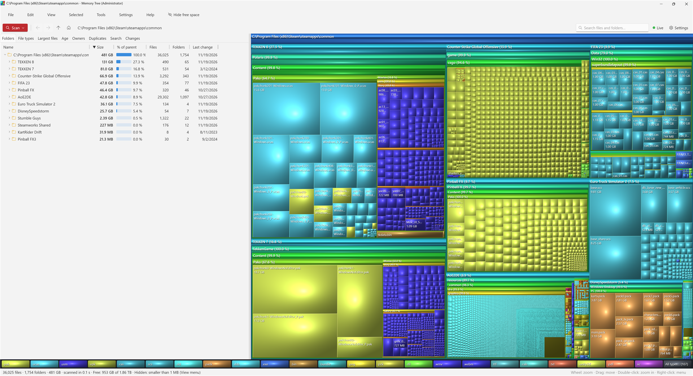
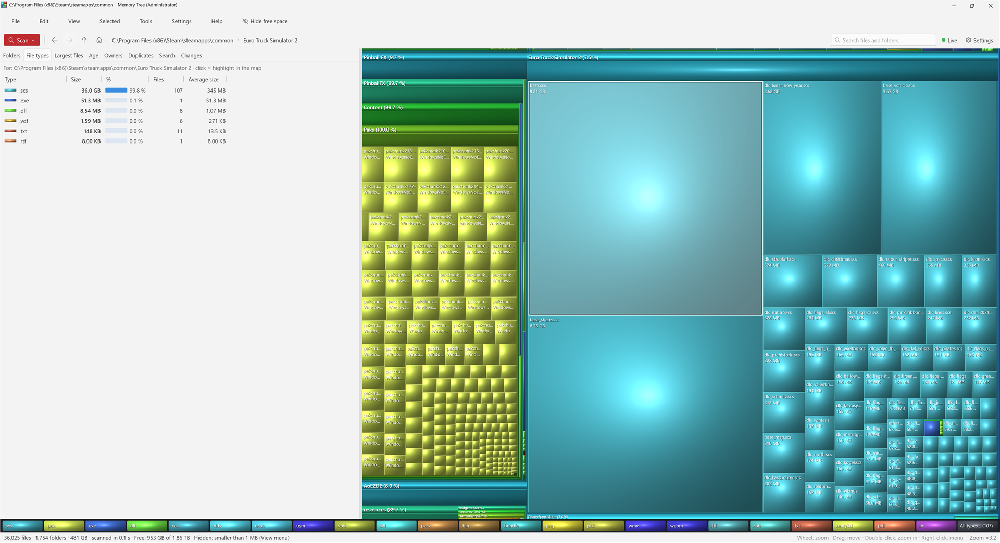

# Memory Tree — Preview

**See what fills your disk, at a glance.** Memory Tree is a free disk space analyzer for Windows with a colorful, shiny "cushion" map of every file and folder. Zoom in with the mouse wheel down to the smallest file, find the big ones, the old ones and the duplicates, and free up space safely.

[**⬇ Download the latest version**](https://github.com/sparrowaddons-prog/memory-tree/releases/latest) · [Ελληνικά ↓](#ελληνικά)

## Highlights

- **Treemap that never freezes.** Every file is a tile sized by the space it really takes on disk. Zoom with the mouse wheel, drag to move, double-click to step into a folder.
- **Fast.** A whole NTFS drive with about 1.4 million files in roughly 4 seconds when run as administrator (it reads the drive's file table directly). Without administrator rights it still works, only slower.
- **Real sizes.** Everything is measured as space used on disk, and hard links are counted once.
- **Analysis tabs:** folders, file types, largest files, age, owners, duplicates, search, and changes since an earlier scan.
- **Type colors.** The color bar under the map shows the file types you are looking at, and it follows your zoom.
- **Duplicate finder** that leaves out files Windows and your programs need.
- **Cleanup** for temporary files and the Recycle Bin. Browser caches are offered but never ticked by default.
- **Safe actions.** Delete, move, copy, rename and zip several items at once, with undo. **Deleted files always go to the Recycle Bin.** Windows' own folders can never be deleted, moved or renamed.
- **History and compare.** It remembers earlier scans and shows what grew, shrank, appeared or disappeared.
- **Export** to Excel (.xlsx), CSV, HTML, PDF/print, or save the map as PNG/JPG.
- **Live updates** while files change, a **Ctrl+K** command palette, and an optional "Open in Memory Tree" entry in File Explorer's right-click menu.
- **English and Greek**, light and dark theme (it follows Windows).
- **Private.** No account, no ads, no internet connection, nothing is sent anywhere.
- **Portable.** One .exe, nothing to install. Settings are saved next to the .exe.

## Getting started

1. Download `MemoryTree-1.0.0-preview-win-x64.zip` from [Releases](https://github.com/sparrowaddons-prog/memory-tree/releases/latest) and unzip it into any folder you like (for example `Documents\Memory Tree`).
2. Run `MemoryTree.exe` and pick a drive or a folder.
3. Optional: use **Restart as administrator** in the program for the fast scan.

**Windows says "Windows protected your PC"?** This is normal for new programs from small developers that don't have a paid code-signing certificate. Click **More info → Run anyway**. Memory Tree doesn't connect to the internet and doesn't install anything.

Requirements: Windows 10 or 11, 64-bit. Nothing else is needed (.NET is built in). Tested on Windows 11.

## Feedback

This is a **preview**: your feedback decides what comes next.

- Found a bug? → [Report a problem](https://github.com/sparrowaddons-prog/memory-tree/issues/new?template=bug.yml)
- Have an idea? → [Suggest a feature](https://github.com/sparrowaddons-prog/memory-tree/issues/new?template=idea.yml)
- Like it? A ⭐ on this page helps a lot.

## License

Free to use at home and at work. Please don't re-upload or sell it; share the link to this page instead. See [LICENSE.txt](LICENSE.txt). The source code is not public.

---

## Ελληνικά

**Δες με μια ματιά τι γεμίζει τον δίσκο σου.** Το Memory Tree είναι δωρεάν πρόγραμμα για Windows που δείχνει κάθε αρχείο και φάκελο ως χρωματιστό, γυαλιστερό «μαξιλαράκι». Κάνεις ζουμ με τη ροδέλα μέχρι το πιο μικρό αρχείο, βρίσκεις τα μεγάλα, τα παλιά και τα διπλά, και ελευθερώνεις χώρο με ασφάλεια.

[**⬇ Κατέβασε την τελευταία έκδοση**](https://github.com/sparrowaddons-prog/memory-tree/releases/latest)

**Τι κάνει:**
- **Χάρτης που δεν κολλάει.** Ζουμ με τη ροδέλα, σύρσιμο για μετακίνηση, διπλό κλικ για να μπεις σε φάκελο.
- **Γρήγορο.** Ολόκληρος δίσκος NTFS με ~1,4 εκατομμύρια αρχεία σε ~4 δευτερόλεπτα ως διαχειριστής. Δουλεύει και χωρίς διαχειριστή, απλώς πιο αργά.
- **Πραγματικά μεγέθη.** Ο χώρος που πιάνει κάθε αρχείο στον δίσκο, και τα hardlinks μετριούνται μία φορά.
- **Καρτέλες:** φάκελοι, τύποι αρχείων, μεγαλύτερα αρχεία, ηλικία, ιδιοκτήτες, διπλότυπα, αναζήτηση, αλλαγές από προηγούμενη σάρωση.
- **Χρώματα τύπων.** Η μπάρα κάτω από τον χάρτη δείχνει τους τύπους που βλέπεις και ακολουθεί το ζουμ.
- **Εύρεση διπλότυπων.** Αφήνει έξω τα αρχεία που χρειάζονται τα Windows και τα προγράμματά σου.
- **Καθαρισμός** προσωρινών αρχείων και Κάδου. Η cache των browser προτείνεται, αλλά δεν τσεκάρεται ποτέ μόνη της.
- **Ασφαλείς ενέργειες.** Διαγραφή, μετακίνηση, αντιγραφή, μετονομασία και zip σε πολλά μαζί, με αναίρεση. **Ό,τι διαγράφεις πάει πάντα στον Κάδο Ανακύκλωσης.** Οι φάκελοι των Windows δεν διαγράφονται, δεν μετακινούνται και δεν μετονομάζονται ποτέ.
- **Ιστορικό και σύγκριση.** Θυμάται παλιές σαρώσεις και δείχνει τι μεγάλωσε, τι μίκρυνε, τι προστέθηκε και τι χάθηκε.
- **Εξαγωγή** σε Excel, CSV, HTML, PDF/εκτύπωση, και εικόνα του χάρτη σε PNG/JPG.
- **Ζωντανή ενημέρωση**, παλέτα εντολών **Ctrl+K**, και προαιρετικά «Άνοιγμα στο Memory Tree» στο δεξί κλικ της Εξερεύνησης.
- **Ελληνικά και αγγλικά**, ανοιχτό και σκούρο θέμα (ακολουθεί τα Windows).
- **Ιδιωτικό.** Χωρίς λογαριασμό, χωρίς διαφημίσεις, χωρίς ίντερνετ· δεν στέλνει τίποτα πουθενά.
- **Φορητό.** Ένα .exe, χωρίς εγκατάσταση.

**Ξεκίνημα:**
1. Κατέβασε το zip από τα [Releases](https://github.com/sparrowaddons-prog/memory-tree/releases/latest) και αποσυμπίεσέ το σε όποιον φάκελο θέλεις.
2. Άνοιξε το `MemoryTree.exe` και διάλεξε δίσκο ή φάκελο.
3. Προαιρετικά, πάτα **Επανεκκίνηση ως διαχειριστής** για τη γρήγορη σάρωση.

**Τα Windows γράφουν «Τα Windows προστάτευσαν τον υπολογιστή σας»;** Είναι φυσιολογικό για νέα προγράμματα χωρίς πληρωμένη ψηφιακή υπογραφή. Πάτα **Περισσότερες πληροφορίες → Εκτέλεση οπωσδήποτε**.

**Σχόλια:** είναι **δοκιμαστική έκδοση (preview)** και η γνώμη σου μετράει. [Ανέφερε πρόβλημα](https://github.com/sparrowaddons-prog/memory-tree/issues/new?template=bug.yml) · [Πρότεινε ιδέα](https://github.com/sparrowaddons-prog/memory-tree/issues/new?template=idea.yml) · ένα ⭐ βοηθάει πολύ.

**Άδεια:** δωρεάν χρήση στο σπίτι και στη δουλειά. Μην το ξανανεβάζεις αλλού και μην το πουλάς· μοιράσου καλύτερα το link αυτής της σελίδας. Δες το [LICENSE.txt](LICENSE.txt). Ο κώδικας δεν είναι δημόσιος.
